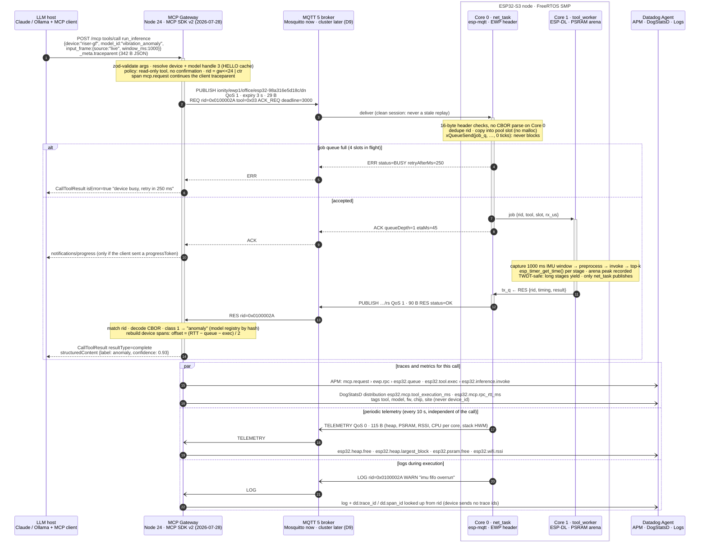

<!--
========================================================================================
AEDI - IONITY GLOBAL - ESP32-MCP SERVER & EDGE-AI FIRMWARE ECOSYSTEM
Author: Johan Wilhelm van Antwerp | Ionity (Pty) Ltd | Ionity Global (Pty) Ltd | AEDI
Document ID: DOC-2026-10-ESP32MCP-ARCH-P1 | Version: 1.1.0 | Updated: 2026-10-11 SAST
Governance: Policy 986 AED | License: AED 900 | CC BY-NC-SA 4.0 where stated
(c) 2018-2026 Antwerp Designs | Ionity (Pty) Ltd | Ionity Global (Pty) Ltd - All Rights Reserved - TM2
Web: https://www.ionity.today | https://www.ionity.world | Ref: https://www.ionity.co.za
Classification: PUBLIC | Building Tomorrow, Today. | Anything is Possible with God.
========================================================================================
-->

# ESP32-MCP revamp — Phase 1: Architecture & Interfaces

**Status:** approved (`PROCEED`, 2026-10-11) · **v1.1** records the decisions taken at PROCEED (§1, D9–D12;
§8) and one correction (the EMQX licence, §8) · **Scope:** monorepo layout, end-to-end `run_inference`
sequence, the gateway↔ESP32 wire contract (EWP/1) · **Next:** Phase 2 provisioning portal
(`PHASE-2-PORTAL.md`).

Phase 1 is additive: it adds `packages/protocol/` and `docs/architecture/`. Nothing existing is moved
until the layout below is approved.

---

## 0. Starting point (v2.2.0, audited 2026-10-11)

| Component | Today | Gap against the target |
|---|---|---|
| Firmware 2.1.1 `firmware-arduino/Esp32_MCP_Node` | Arduino core 3.3.11 (pioarduino), ArduinoJson 7, PubSubClient | The board parses full MCP JSON-RPC; tools run synchronously in `loop()`; MQTT 3.1.1 only; 4 KB JSON buffers per message |
| Fleet host 2.2.0 `server/` | Python FastAPI, MCP JSON-RPC (2025-06-18), 18 fleet tools, registry + SQLite, alerts, LAN DNS | No traces; Datadog via HTTP API (metrics/events/checks only); the device bridge forwards JSON-RPC verbatim |
| Flasher 2.0 `flasher/` | React 19, esptool-js 0.7, Web Serial, `ionity-prov/1` JSON-line provisioning, keep-NVS flashing | No terminal, no device UUID, no EWP awareness |
| Plan v3 `docs/PLAN-v3-ESP-CENTRIC.md` | NetObserve tools on the board | Tool ids `0x40–0x5F` are reserved for it in EWP/1 |

## 1. Decisions

| # | Decision | Rationale |
|---|---|---|
| D1 | **Gateway in Node 24 LTS + TypeScript** on the MCP TypeScript SDK v2 (`@modelcontextprotocol/server` 2.3.x, spec **2026-07-28**). The Python host becomes `services/fleet-host` and is retired feature by feature (strangler). | 2026-07-28 MCP is stateless (no `initialize`, no `Mcp-Session-Id`), so gateway instances scale out with no session affinity. One language with the portal; the wire types are shared, not re-typed. The 18 Python tools keep working during migration. |
| D2 | **EWP/1 wire format:** 16-byte little-endian header + one CBOR body with 1-byte integer keys. | Core 0 routes a frame without a CBOR parser. Measured: `run_inference` request **29 B vs 342 B** MCP JSON (11.8×). |
| D3 | **MQTT 5 primary, WSS secondary, same frames.** Devices use clean sessions; `dn` messages carry MQTT 5 message-expiry = REQ deadline. | Broker fan-out, Last Will presence, per-device ACLs. Correctness never depends on an MQTT 5 feature, so the bundled MQTT 3.1.1 testers broker still works. |
| D4 | **Firmware: ESP-IDF C++** in one tree that builds with PlatformIO (pioarduino, already in use) **and** `idf.py` in CI. Target IDF 5.5 now, 6.x-ready. | Full `sdkconfig` control (PSRAM, core dump, MQTT 5, TWDT). IDF 6.0 removed the legacy ADC/DAC/I2S/RMT/MCPWM/PCNT/timer/temp-sensor drivers and moved esp-mqtt and cJSON to the Component Registry, so new code uses the new driver APIs and declares those as managed components from day one. |
| D5 | **Identity:** `hwid` = `esp32-<base MAC>` on the wire, as MQTT client id and in ACLs; the provisioned **device UUID** (RFC 9562) is the logical asset id, announced in HELLO. | Keeps fw 2.x ids, topics and ACLs. The UUID survives a board swap. |
| D6 | **Fleet-shaped MCP surface:** the gateway exposes generic tools with a `device` argument (+ fleet tools), never one MCP server or tool set per board. | 100k boards cannot become 100k tool lists; `tools/list` stays deterministic and cacheable (`ttlMs`, `cacheScope`). |
| D7 | **Datadog via the Agent** (APM, DogStatsD, Logs) with `dd-trace` 6.x. Device spans are rebuilt from device-measured durations; per-device values go out as distributions without a `device_id` tag. | End-to-end traces. Avoids custom-metric cardinality blow-up and gauge collisions at fleet scale. |
| D8 | **Fail-safe actuation:** risky tools are confirmed through MCP multi round-trip (MRTR) — see D10; actuator writes may carry a dead-man lease; FAILSAFE can be broadcast with a `PRIORITY` flag. | An LLM-driven relay must never be left ON because a session died. |
| D9 | **Broker: Mosquitto now, a cluster later.** Lab, pilots and first customers run Mosquitto (self-hosted in South Africa or on the customer's site). Move to a cluster — EMQX with a commercial licence, or a managed MQTT service in an approved region — when failover is needed or the fleet passes ~10 000 boards, chosen from measured traffic. | Mosquitto is free for commercial use, already in the repo and covers everything EWP/1 needs (MQTT 5, LWT, ACLs, TLS). Its limit is one server without automatic failover. The gateway speaks standard MQTT only, so the switch is configuration, not a rewrite. |
| D10 | **Confirm every risky command.** Any tool call from an LLM/MCP client that changes hardware state or settings (`set_actuator`, `set_state_mode`, provisioning, OTA, factory reset) needs a human confirmation: MRTR in the MCP client, or an approval link. Two narrow exceptions: operator-defined rules (e.g. the YouTube red-light alarm) are approved once when they are set up; **entering** FAILSAFE is immediate, **leaving** it needs confirmation. | The user's rule. Safety-first ordering: stopping things is never delayed, starting things always has a human in the loop. |
| D11 | **Restructure after Phase 3.** Existing folders stay where they are until the ESP-IDF firmware lands; Phases 1–3 only add `packages/`, `apps/portal/` and `docs/architecture/`. | Nothing in the field or in the lab scripts breaks mid-revamp. |
| D12 | **npm workspaces for the TypeScript side** (root `package.json`: `packages/*`, `apps/*`). pnpm + turbo are reconsidered at the restructure. | No new tool to install on the lab PCs today; the workspace layout is the same either way. |

## 2. Monorepo layout (target)

```text
Esp32-MCP/                      github.com/dennisGIonity/Esp32-MCP (copy → Ionity-Global-Pty-Ltd)
├─ apps/
│  ├─ portal/                   React 19 · Vite 8 · Tailwind 4 · esptool-js · xterm.js  ← flasher/  (Phase 2)
│  │  ├─ src/features/device/      DeviceConsole (core component), connection, board card
│  │  ├─ src/features/provision/   ionity-prov/2 form (prov/1-compatible), pairing checklist
│  │  ├─ src/features/console/     xterm.js console, secret scrubbing, Save log
│  │  ├─ src/features/flash/       esptool-js through a port lease, keep-NVS, SHA-256 checked
│  │  ├─ src/lib/serial/           single-owner Web Serial session (DTR/RTS-safe, re-enumeration)
│  │  └─ src/sim/                  ?simulate=v1|v2|v2-usb boards for demos and end-to-end tests
│  └─ gateway/                  Node 24 LTS · TypeScript · MCP SDK v2                   (new)
│     ├─ src/mcp/                  Streamable HTTP + stdio, tool registry, MRTR confirms
│     ├─ src/tools/                run_inference · set_actuator · read_telemetry · …
│     ├─ src/link/                 mqtt.ts (MQTT 5) · ws.ts (WSS) · rpc.ts (rid, deadline)
│     ├─ src/registry/             HELLO cache, presence (STATUS/LWT), hwid ↔ uuid ↔ label
│     ├─ src/devops/               OTA campaigns, build triggers, ELF archive
│     ├─ src/observability/        dd-trace, span rebuild, DogStatsD, crash symboliser
│     └─ src/api/                  REST for the portal: defaults, enrolment, manifest
├─ firmware/
│  ├─ esp32-node/               ESP-IDF C++ · PlatformIO (espidf) + idf.py              (new)
│  │  ├─ platformio.ini · CMakeLists.txt · idf_component.yml · partitions.csv
│  │  ├─ sdkconfig.defaults · sdkconfig.defaults.esp32s3 · sdkconfig.defaults.esp32c6
│  │  ├─ main/main.cpp             boot, NVS, task topology (Core 0 net / Core 1 tools)
│  │  ├─ components/ewp/           frame codec (tinycbor) + ewp_protocol.h (generated)
│  │  ├─ components/mcp_server/    MCPServer.h: registry, job pool, worker tasks
│  │  ├─ components/net/           wifi_mgr · mqtt_link (MQTT 5) · ws_link · sntp
│  │  ├─ components/tools/         the four edge tools + identify · get_device_info
│  │  ├─ components/edge_ai/       ESP-DL / TFLM runners, PSRAM arenas, model manifest
│  │  ├─ components/actuators/     LEDC / SDM / GPIO channels, leases, FAILSAFE latch
│  │  ├─ components/provisioning/  ionity-prov/2 over UART/USB-CDC, NVS v2 + v1 migration
│  │  ├─ components/crash/         core-dump summary → CRASH frame on next boot
│  │  ├─ components/http_mcp/      optional LAN JSON-RPC MCP (espressif/mcp-c-sdk)
│  │  └─ test/                     Unity tests + golden vectors from packages/protocol
│  ├─ legacy-arduino/           fw 2.x sketches, frozen (bug fixes only)  ← firmware-arduino/
│  └─ tools/                    build.py → images + manifest + ELF archive ← firmware/build.py
├─ packages/
│  ├─ protocol/                 @ionity/ewp — EWP/1 wire contract                 (Phase 1)
│  ├─ provisioning/             @ionity/prov — NVS record v2 schema               (Phase 2)
│  └─ tsconfig/                 strict presets (the protocol tsconfig, promoted)
├─ services/
│  ├─ fleet-host/               Python FastAPI 2.2, retired step by step ← server/ + dashboard/
│  └─ network-sentinel/                                      ← modules/network-sentinel/
├─ devices/pi-agent/            unchanged
├─ infra/
│  ├─ mosquitto/                lab broker, ACL generated from CHANNEL_POLICY ← infra/mosquitto/
│  ├─ broker-cluster/           later (D9): EMQX (licensed) or managed MQTT, chosen from real traffic
│  ├─ datadog/                  agent (APM + DogStatsD + logs), dashboards, monitors
│  ├─ pki/                      fleet CA + device certificates (no keys in git)
│  └─ compose/                  lab stack: broker + gateway + fleet-host + agent ← docker-compose.yml
├─ tools/
│  ├─ ewp-emulator/             N virtual EWP/1 boards for load tests and CI
│  ├─ scripts/                  lab start/stop/status, provision.py, net_watch.py ← scripts/
│  └─ packaging/                testers + POC kits                               ← packaging/
├─ docs/                        + architecture/ · adr/
├─ .github/workflows/           npm workspaces · pytest · idf.py matrix (S3, C6) · vectors · header drift
└─ package.json (npm workspaces, D12) · tsconfig.base.json · .nvmrc (24)
```

**Migration rules.** The fw 2.x JSON topics (`ionity/<site>/<id>/…`) and EWP topics (`ionity/ewp1/…`)
live on one broker side by side, so mixed fleets keep working. The Python host keeps its MCP endpoint
until the gateway reaches tool parity, then its endpoint is removed and it serves data only.

## 3. `run_inference` end to end



Source: [`run_inference_sequence.mmd`](run_inference_sequence.mmd).

**Device spans without a device clock.** The board has no RTC, so its timestamps are never used.
The gateway records publish time `t0` and RES arrival `t3`; the device reports `queueUs` and
`execUs` (monotonic `esp_timer_get_time()`). One-way delay `d = max(0, (t3 − t0 − queueUs − execUs) / 2)`;
the `esp32.queue` span starts at `t0 + d` and `esp32.tool.exec` follows it. Spans are created with
`tracer.startSpan(name, { childOf, startTime })` and closed with `span.finish(endTime)`.

**Trace continuity.** The 2026-07-28 spec defines W3C `traceparent` / `tracestate` in `_meta`.
`dd-trace` 6.20 instruments only the v1 SDK package (`@modelcontextprotocol/sdk` ≥ 1.27.1, via
`_meta._dd_trace_context`), so the gateway extracts both keys itself and opens `mcp.request`.

**Unhappy paths.** BUSY (queue full) answers immediately with `retryAfterMs`. If no RES arrives by
`deadline + 1.5 s` the gateway publishes CANCEL and returns `isError: true` ("device did not answer
in 3 s") — a tool error the model can reason about, not a protocol error. A job still queued when its
budget runs out is answered `DEADLINE_EXCEEDED` and never executed.

## 4. EWP/1 — the wire contract

Source of truth: `packages/protocol` (TypeScript). `generated/ewp_protocol.h` is produced from it.

### 4.1 Header (16 bytes, little-endian, naturally aligned)

| Offset | Size | Field | Notes |
|---:|---:|---|---|
| 0 | 1 | `magic` | `0xE5` — not `{`, `[` or a CBOR map head, so legacy JSON on the wrong topic is rejected at byte 0 |
| 1 | 1 | `version` | `1` |
| 2 | 1 | `type` | REQ, ACK, RES, ERR, CANCEL, TELEMETRY, EVENT, LOG, CRASH, HELLO, STATUS |
| 3 | 1 | `flags` | ACK_REQUESTED, BROADCAST, PRIORITY, BUFFERED, TRUNCATED — unknown bits rejected |
| 4 | 4 | `rid` | `(gateway instance << 24) \| counter` for REQ; per-boot sequence for device frames |
| 8 | 1 | `tool` | tool id, `0` for non-tool frames |
| 9 | 1 | `status` | `0` OK, `1` ACCEPTED, `0x10+` errors |
| 10 | 2 | `deadlineMs` | REQ budget relative to receipt (no clock sync needed) |
| 12 | 2 | `bodyLen` | CBOR body length; `16 + bodyLen` must equal the payload length |
| 14 | 2 | `reserved` | must be `0` |

### 4.2 Topics — `ionity/ewp1/<site>/<hwid>/<channel>`

| Channel | Direction | QoS | Retained | Frames |
|---|---|---:|:-:|---|
| `dn` | gateway → device | 1 | – | REQ, CANCEL (message-expiry = deadline) |
| `rs` | device → gateway | 1 | – | ACK, RES, ERR |
| `tm` | device → gateway | 0 | – | TELEMETRY |
| `ev` | device → gateway | 1 | – | EVENT, LOG, CRASH |
| `hello` | device → gateway | 1 | ✓ | HELLO (capabilities) |
| `st` | device → gateway | 1 | ✓ | STATUS — also the Last Will (`OFFLINE`) |
| `ionity/ewp1/_all/dn` | gateway → all | 1 | – | BROADCAST requests only; devices jitter replies 0–2 s |

Responses go to the device's own `rs` topic and every gateway instance subscribes to `rs`
(RPC volume is LLM-driven, so the fan-out is cheap); the instance-prefixed `rid` decides which one owns
the reply. Telemetry uses shared subscriptions. Device ACL: write only under its own `hwid`.

### 4.3 Tool registry

| Id | MCP name | Wire args → result | Flags |
|---|---|---|---|
| `0x01` | `get_device_info` | `{}` → HELLO body | read-only |
| `0x02` | `read_telemetry` | `{sections?}` → TELEMETRY body | read-only |
| `0x03` | `run_inference` | `{model, input: LIVE \| INLINE \| BLOB, topK?, threshold?}` → `{classes[[cls,p]], score?, positive, stages, arenaPeakBytes}` | read-only, long-running |
| `0x04` | `set_actuator` | `{channel, value 0..1, rampMs?, leaseMs?}` → `{applied, previous, leaseRemainingMs?}` | destructive |
| `0x05` | `set_state_mode` | one variant per mode (sleep needs `durationS`, inference needs `model`) → `{previous, current, effectiveInMs, latched}` | destructive |
| `0x06` | `identify` | `{durationMs?}` → `{}` | – |
| `0x40–0x5F` | NetObserve (plan v3) | reserved | – |

The spec's `input_frame: any` is replaced by a bounded union: `LIVE` (device captures its own window),
`INLINE` (≤ 2048 B tensor, `product(shape) × dtype size = data length`), `BLOB` (staged upload, later
phase). The LLM-facing schema accepts base64 for `INLINE`; the gateway sends raw bytes, so the MCU
never decodes base64.

### 4.4 Errors → MCP

Every device-side failure becomes a tool result with `isError: true` and the `detail` text (the model
can correct itself); JSON-RPC protocol errors are reserved for malformed MCP requests. `BUSY`,
`DEADLINE_EXCEEDED`, `NOT_READY` and `RATE_LIMITED` are retryable and carry `retryAfterMs`.

### 4.5 Measured frame sizes (reference CBOR encoding, cross-decoded in Python and C)

| Frame | EWP/1 | JSON equivalent | Ratio |
|---|---:|---:|---:|
| `run_inference` request | 29 B | 342 B (MCP `tools/call` with `_meta`) | 11.8× |
| `run_inference` result | 90 B | 887 B (MCP `CallToolResult`) | 9.9× |
| `run_inference` request vs fw 2.x MQTT envelope | 29 B | 184 B | 6.3× |
| Telemetry sample | 115 B | 476 B (fw 2.x JSON) | 4.1× |

Request on the wire: `e5 01 01 01 2a 00 00 01 03 00 b8 0b 0d 00 00 00 | a3 01 03 02 a2 01 00 02 19 03 e8 03 03`
= header (REQ, ACK_REQUESTED, rid `0x0100002A`, tool 3, deadline 3000 ms, body 13 B) + `{1: 3, 2: {1: 0, 2: 1000}, 3: 3}`.

### 4.6 Compatibility rules

- Ids, keys and header offsets are append-only. A breaking change bumps `version`; HELLO `proto` is `[min, max]`.
- Decoders ignore unknown CBOR keys (forward compatible) but reject unknown header flags (safety).
- Float fields may arrive as CBOR integers (a JS encoder cannot tell `1.0` from `1`); decoders accept both.
- Non-finite floats are rejected on both sides.

## 5. Firmware contract for Phase 3 (memory safety and RTOS)

1. **No allocation on the hot path.** `maxInflight × downlinkFrame` (4 × 4 KiB) job slots are allocated
   once at boot; `net_task` copies a payload into a free slot or answers `BUSY`.
2. **Core 0 never blocks on Core 1.** `xQueueSend(job_q, …, 0)` — zero ticks. Back-pressure is an error
   frame, not a stalled network task.
3. **One publisher.** Only `net_task` calls `esp_mqtt_client_publish`; MQTT 5 publish properties are a
   one-shot setting before each publish and are not safe to interleave across tasks. Workers enqueue to `tx_q`.
4. **Memory placement.** Tensor arenas, log rings and the frame pool live in PSRAM
   (`MALLOC_CAP_SPIRAM`); DMA buffers (I2S mic, SPI) stay in internal RAM (`MALLOC_CAP_DMA`). Any task that
   writes NVS or flash keeps its stack in internal RAM — the cache is disabled during flash writes.
5. **Watchdog-safe inference.** Long stages yield so `IDLE1` runs; the worker subscribes to the TWDT
   explicitly.
6. **Fragmentation is a first-class metric.** Telemetry reports `heap_caps_get_largest_free_block`; a board
   whose largest block drops below one frame can no longer receive a request.
7. **Validation order** (cheap → expensive): length, magic, version, flags, reserved, `16 + bodyLen`,
   size limit, type allowed on this topic, tool registered, rid not in the dedupe window, slot free.
8. **No stale actuation.** Clean MQTT sessions, message expiry, device-side deadline check, rid dedupe
   window, leases that revert to `safe`, FAILSAFE latched in NVS (fw 2.x behaviour kept).
9. **Chip-aware.** ESP32-S3 has no DAC (analog outputs are SDM or LEDC + RC). ESP32-C6 is single-core:
   the same tasks run unpinned with net priority above tools; the C6 modules we target have no PSRAM,
   so HELLO reports `psramMb = 0` and the gateway hides models whose arena does not fit.

## 6. Datadog mapping

| Metric | Type | Source | Tags |
|---|---|---|---|
| `esp32.mcp.tool_execution_ms` | distribution | RES `execUs` | tool, model, fw, chip, site, status |
| `esp32.mcp.queue_wait_ms` | distribution | RES `queueUs` | tool, site |
| `esp32.mcp.rpc_rtt_ms` | distribution | gateway publish → RES | tool, transport, site |
| `esp32.mcp.errors` | count | ERR frames | tool, status |
| `esp32.heap.free` / `.min_free` / `.largest_block` | distribution | TELEMETRY heap | site, fw, chip |
| `esp32.heap.fragmentation` | distribution | `1 − largest / free` | site, fw |
| `esp32.psram.free` | distribution | TELEMETRY heap | site, fw |
| `esp32.wifi.rssi` | distribution | TELEMETRY net | site |
| `esp32.cpu.load` | distribution | TELEMETRY cpu | site, core |
| `esp32.task.stack_free_min` | distribution | TELEMETRY tasks | task, fw |
| `esp32.inference.arena_peak_bytes` | distribution | RES result | model, fw |
| `esp32.fleet.online` | gauge | registry | site, fw |

**Cardinality rule.** No `device_id` tag on metrics. Dropping it from a *gauge* would make 1 000 boards
overwrite one series, so per-device values go out as *distributions* (fleet percentiles per fw/site).
A bounded allow-list (≤ 50 watched boards, e.g. the demo board) may emit per-device gauges.
`device_id` lives on traces and logs, which are not priced per tag combination.

**Logs.** LOG frames → Datadog Logs with `dd.trace_id` / `dd.span_id` looked up from `rid`.
CRASH frames → symbolised with `addr2line` against the archived ELF (matched by `elfSha`) →
`error.kind: GuruMeditation`, `error.stack`, so Error Tracking groups crashes by stack.

## 7. Security baseline

- Per-device X.509 (mTLS) to the broker; on ESP32-S3 the private key is protected by the Digital Signature
  peripheral. Broker ACL: write only below `ionity/ewp1/+/<own hwid>/`.
- Production boards: secure boot v2, flash encryption, NVS encryption (HMAC scheme). Consequence for
  Phase 2: provisioning always goes **through the firmware** (`ionity-prov/2` over serial); the portal
  never writes a raw NVS image, which it could not encrypt.
- Gateway: OAuth per the MCP authorization spec for remote clients; bearer token for LAN stdio; destructive
  tools gated by policy (MRTR confirmation for `hazardous` channels and broadcasts).

## 8. Decisions taken at PROCEED (2026-10-11)

| Question (v1.0) | Answer | Recorded as |
|---|---|---|
| Gateway runtime: Node/TypeScript or Python FastMCP | **Node/TypeScript** | D1 |
| Fleet broker: EMQX (proposed) or a managed service | **Mosquitto now; cluster (licensed EMQX or managed, approved region) later** | D9 |
| Confirmation policy | **Confirm every risky command** (exceptions: operator rules approved at setup; FAILSAFE entry immediate) | D10 |
| Restructure timing | **After Phase 3** | D11 |

**Correction to v1.0.** v1.0 proposed EMQX for the fleet tier without its licence terms. EMQX 5.9 and later
are published under the Business Source License 1.1: a single node is free to use, but not when it is offered
as a service or embedded in a product that is sold, and clustering always needs a commercial licence. That is
why D9 starts on Mosquitto and leaves the cluster choice to the point where failover is actually needed.
AWS IoT Core has no Cape Town (af-south-1) endpoint, and HiveMQ Cloud Starter is hosted in the EU/US only —
inputs for the "approved region" question when the time comes.

## 9. Verification log (2026-10-11)

- `packages/protocol` type-checks with `strict`, `exactOptionalPropertyTypes`, `noUncheckedIndexedAccess`,
  `erasableSyntaxOnly` under **TypeScript 5.9.3 and 7.0.2**; 11 negative compile-time checks (`@ts-expect-error`:
  raw numbers, wrong body for a tool, missing/extra/duplicate/2-byte CBOR keys, uplink frame on the downlink,
  `undefined` for an optional field …) plus positive cases, and 9 runtime guard tests pass (Node 22, type stripping).
- `generated/ewp_protocol.h` compiles as **C11 and C++17** with `-Wall -Wextra -Werror -pedantic`;
  `static_assert`s pin size and every offset.
- Sample REQ / RES / TELEMETRY frames encoded from the TypeScript contract were decoded by **Python
  `cbor2`** (independent CBOR implementation) and by the **generated C header** (header fields, length check).
- The sequence diagram renders with `@mermaid-js/mermaid-cli` 12.0.0.
- v1.1 (2026-10-11): `packages/protocol` re-checked inside the npm workspace (type-check + 9 runtime tests);
  its `package.json` now exports `./src/index.ts` so the portal and gateway import the TypeScript source
  directly (Node ≥ 22.18 type stripping, Vite in the browser).

## 10. Change log

| Version | Date | Change |
|---|---|---|
| 1.0.0 | 2026-10-11 | First issue for PROCEED |
| 1.1.0 | 2026-10-11 | Decisions D9–D12 and §8 recorded; EMQX licence correction; monorepo tree updated to the Phase 2 portal layout, `infra/broker-cluster`, npm workspaces; sequence diagram broker label |

---

*Governance: Policy 986 AED · Licence AED 900 · © 2018-2026 Antwerp Designs | Ionity (Pty) Ltd | Ionity Global (Pty) Ltd · TM2 ·
[www.ionity.today](https://www.ionity.today) · [www.ionity.world](https://www.ionity.world)*
