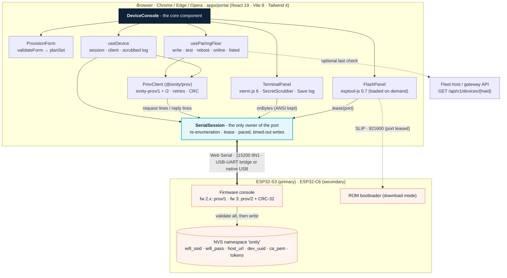
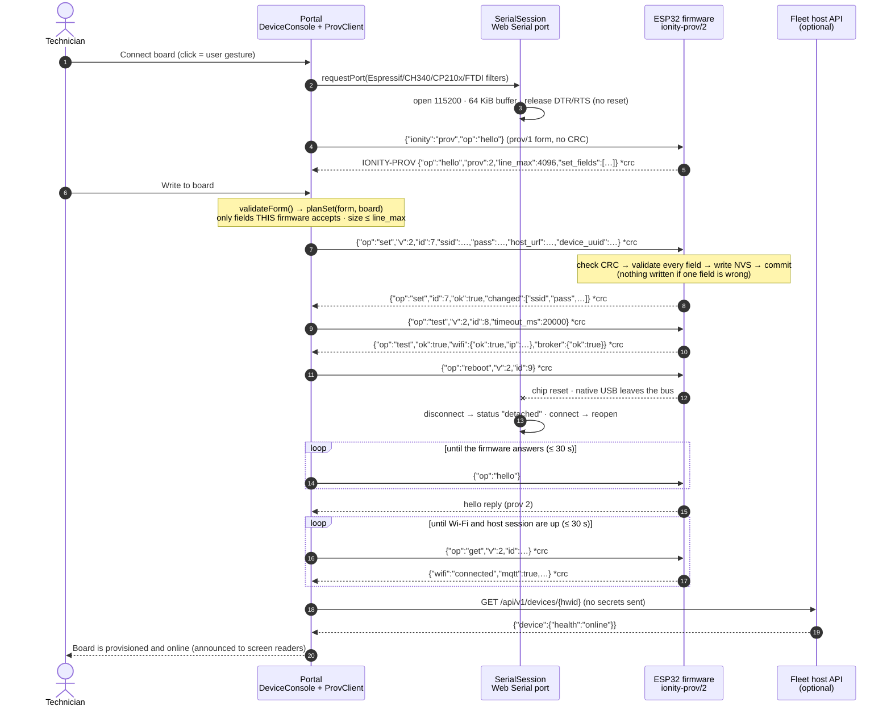
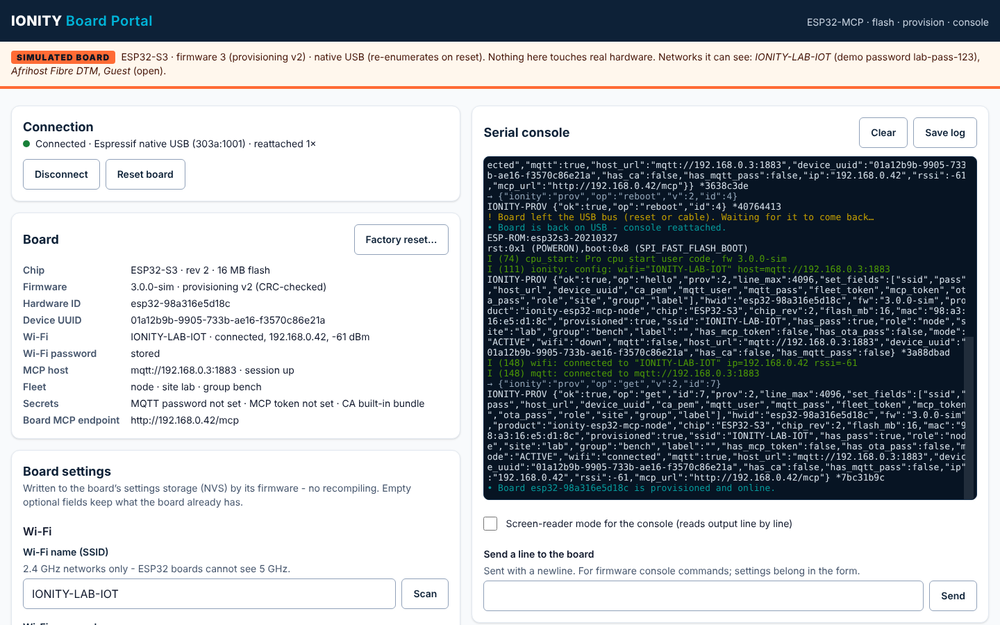
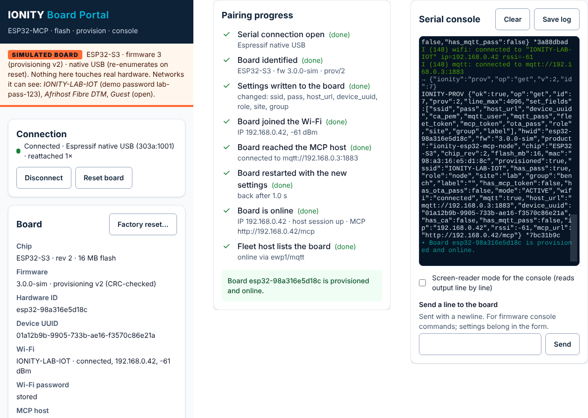

<!--
========================================================================================
AEDI - IONITY GLOBAL - ESP32-MCP SERVER & EDGE-AI FIRMWARE ECOSYSTEM
Author: Johan Wilhelm van Antwerp | Ionity (Pty) Ltd | Ionity Global (Pty) Ltd | AEDI
Document ID: DOC-2026-10-ESP32MCP-PORTAL-P2 | Version: 1.0.0 | Updated: 2026-10-11 SAST
Governance: Policy 986 AED | License: AED 900 | CC BY-NC-SA 4.0 where stated
(c) 2018-2026 Antwerp Designs | Ionity (Pty) Ltd | Ionity Global (Pty) Ltd - All Rights Reserved - TM2
Web: https://www.ionity.today | https://www.ionity.world | Ref: https://www.ionity.co.za
Classification: PUBLIC | Building Tomorrow, Today. | Anything is Possible with God.
========================================================================================
-->

# ESP32-MCP revamp — Phase 2: Provisioning Portal

**Status:** delivered — waiting for `PROCEED` to Phase 3 · **Scope:** the core React component that connects
to an ESP32 over Web Serial, writes its NVS provisioning data (Wi-Fi + MCP host + device UUID) through the
firmware, and streams the serial output into xterm.js · **Next:** Phase 3, ESP-IDF firmware (`main.cpp`,
`MCPServer.h`, `read_telemetry` on a FreeRTOS worker).

Phase 2 is additive, as agreed (D11): it adds `packages/provisioning/` (`@ionity/prov`), `apps/portal/` and
this document, and touches nothing that runs today. The old `flasher/` keeps working until the restructure.

---

## 0. What Phase 2 delivers

| Deliverable | Where | Result |
|---|---|---|
| **Core component** `DeviceConsole` | `apps/portal/src/features/device/DeviceConsole.tsx` | Connect → identify → write NVS → join Wi-Fi → reach host → reboot → online → listed, with a live xterm console beside it |
| Serial session (single port owner) | `apps/portal/src/lib/serial/session.ts` | Survives native-USB re-enumeration, never resets the board on open, lends the port to esptool-js |
| `ionity-prov/2` contract + client | `packages/provisioning` (`@ionity/prov` 0.2) | Backward compatible with fw 2.x (`ionity-prov/1`); CRC-32 framing, request ids, validate-then-write |
| Provisioning form | `apps/portal/src/features/provision/` | Field-level validation that mirrors the firmware; only fields the connected firmware accepts are sent |
| Console | `apps/portal/src/features/console/` | xterm.js 6, colours kept, secrets masked, bounded memory, Save log |
| Firmware install | `apps/portal/src/features/flash/`, `src/lib/flash/` | esptool-js 0.7 via a port lease; SHA-256 and chip checks; keeps NVS by default |
| Simulator | `?simulate=v1 \| v2 \| v2-usb` | fw 2.x board, fw 3 board, fw 3 board on native USB — for demos, training and CI |
| Verification | `apps/portal/test`, `apps/portal/e2e` | 55 unit tests, 5 browser scenarios, axe-core 0 violations (§10) |

## 1. Decisions confirmed at PROCEED (2026-10-11)

| # | Decision | Effect on Phase 2 |
|---|---|---|
| D1 | Gateway in Node/TypeScript | `@ionity/prov` is plain TypeScript with no DOM or Node typings, so the gateway's enrolment API will import the same validation and the same NVS field list |
| D9 | **Mosquitto now; a cluster later** (licensed EMQX or a managed service in an approved region, chosen from real traffic when failover is needed or the fleet passes ~10 000 boards) | The host URL is a plain `mqtt://` / `mqtts://` / `wss://` URL, so moving a board to a cluster is a re-provision (or an OTA config change), never new firmware |
| D10 | **Confirm every risky command** | Factory reset and "erase the whole flash" ask for confirmation in a dialog (Cancel has focus, Esc cancels); the pairing flow itself is started by a deliberate "Write to board" |
| D11 | Restructure after Phase 3 | Phase 2 adds folders only |
| D12 | npm workspaces at the root | `package.json` → `packages/*`, `apps/*`; `npm install` once at the root |

The Phase 1 document is reissued as **v1.1** with these decisions and one correction: v1.0 proposed EMQX
without its licence terms (BSL 1.1 since 5.9: a single node is free unless offered as a service or embedded
in a sold product; clustering always needs a commercial licence).

## 2. Components



*Source: `portal_components.mmd` (rendered: `portal_components.png`). Arrows mean "uses".*

| Piece | Responsibility | Key safety property |
|---|---|---|
| `SerialSession` | The only code that touches the `SerialPort`: one reader loop, one write chain, the lease | A `ReadableStream` has exactly one reader — the terminal, the provisioning client and esptool-js can never fight over it |
| `ProvClient` (`@ionity/prov`) | Request/reply over lines: correlation, retries, CRC check, board identity | Idempotent ops (`hello`, `get`, `set`, `scan`) are retried; `test`, `reboot`, `factory_reset` never are |
| `planSet()` (`@ionity/prov`) | Turns a valid form into the `set` fields **this** board accepts | What fw 2.x cannot store is reported on the field, never sent and never silently lost |
| `useTerminal` / `TerminalPanel` | xterm.js lifecycle, batching, masking | Bounded: above 1 M unparsed characters new output is counted and dropped, not queued |
| `usePairingFlow` | The eight-step checklist and its failure messages | A failed step stops the flow and says what to fix; Stop aborts every wait |
| `FlashPanel` / `installer.ts` | Firmware download, checks, esptool-js | Nothing is written unless size, SHA-256 and the chip's bootloader magic all match |

## 3. Pairing sequence

The hardest case: firmware 3 on an ESP32-S3 using its native USB port, which drops off the bus at every
reset.



*Source: `pairing_sequence.mmd` (rendered: `pairing_sequence.png`).*

## 4. `ionity-prov/2` — serial provisioning protocol

### 4.1 Framing

- One request per line, host → board: `{"ionity":"prov","op":"<op>",…}\n` (UTF-8 JSON, no newlines inside).
- One reply per line, board → host: `IONITY-PROV {…json…}`. Every other line is ordinary log output and is
  shown in the console untouched.
- **prov/2 additions** (used once the board's hello reply says `"prov":2`): `"v":2` and a numeric `"id"` in
  every request, echoed in the reply; a CRC suffix in both directions: `{…json…} *1a2b3c4d` — CRC-32/ISO-HDLC
  (zlib/Ethernet, reflected 0xEDB88320, check value `crc32("123456789") = 0xCBF43926`) of the JSON text's UTF-8
  bytes, 8 lowercase hex digits.
- **`hello` is always sent in the prov/1 form** (no `v`, no `id`, no CRC). fw 2.x ignores a CRC-suffixed line,
  and after a firmware downgrade the host cannot know the version yet. fw 3 answers it — like every reply —
  with the CRC suffix.
- Line limit: fw 2.x keeps 767 characters (longer lines are dropped without a reply); fw 3 advertises
  `line_max` (≥ 4096). The portal computes the exact request size (envelope and CRC included) and refuses to
  send a line that does not fit.

Why the CRC: fw 3 is multi-task. A log line from another task can land inside a reply on the same UART or
USB-CDC; the suffix turns a silently corrupted reply into a detected one, and the client retries.

### 4.2 Operations

| op | Request fields | Reply (besides `ok`, `op`, `id`) | Client timeout · retries |
|---|---|---|---|
| `hello` | – | board identity (§4.4) | 2.5 s · handshake loop up to 15–30 s |
| `get` | – | board identity | 3 s · 1 retry |
| `set` | fields of §4.3 (only those in `set_fields`) | `changed` (field **names**), `reboot_required`, identity | 6 s · 1 retry (same values: idempotent) |
| `scan` | – | `networks: [{ssid, rssi, ch, open}]` | 15 s · 1 retry |
| `test` | `timeout_ms` (default 15 000, max 30 000) | prov/2: `wifi:{ok, ip, rssi, error}`, `broker:{ok, detail}`, `board`; prov/1: flat | timeout + 6 s · never retried |
| `reboot` | – | sent before the restart | 3 s · never retried |
| `factory_reset` | – | sent before the restart | 4 s · never retried |

Errors: `{"ok":false,"op":"<op>","id":…,"error":"<text>","field":"<name>"}` — `field` (prov/2) names the
rejected `set` field and is shown on that form field. A line whose CRC does not match is answered
`{"ok":false,"op":"error","error":"crc mismatch"}` and **not executed**.

### 4.3 `set` fields → NVS (namespace `ionity`)

| Wire field | NVS key | Rule (checked in the portal **and** by the firmware) | Secret |
|---|---|---|---|
| `ssid` | `wifi_ssid` | 1–32 bytes, no control characters | |
| `pass` | `wifi_pass` | `""` (open) · 8–63 printable ASCII · 64 hex (raw PSK, prov/2 only) | yes |
| `host_url` (prov/2) | `host_url` | canonical `scheme://host:port[/path]` (mqtt, mqtts, ws, wss, http), ≤ 128 bytes, no user:password@, path only for ws/wss, port always written out; `""` = mDNS `ionity-fleet.local` | |
| `server`, `mqtt_port`, `http_port` (prov/1) | same | derived from the host URL for fw 2.x (mqtt:// and http:// only) | |
| `device_uuid` (prov/2) | `dev_uuid` | RFC 9562, canonical lowercase; new boards get a UUIDv7 | |
| `ca_pem` (prov/2) | `ca_pem` | one PEM certificate, ≤ 3072 bytes | |
| `mqtt_user` | `mqtt_user` | ≤ 64 bytes | |
| `mqtt_pass`, `fleet_token`, `mcp_token`, `ota_pass` | same | ≤ 128 bytes; tokens `[A-Za-z0-9._~-]{16,128}` | yes |
| `role` | `role` | `node` \| `standalone` | |
| `site`, `group` | same | `^[a-z0-9][a-z0-9-]{0,31}$` (an MQTT topic level) | |
| `label` | `label` | ≤ 48 bytes, no control characters | |

Empty optional fields mean "leave unchanged". The host URL canonical form always carries the port: the
firmware needs no default-port table, and `http` defaults to the fleet host's 8099, which a standard URL
parser would otherwise read as port 80.

### 4.4 Identity reported by `hello` / `get`

`prov`, `line_max`, `set_fields`, `hwid` (`esp32-<base MAC>`), `fw`, `product`, `chip`, `chip_rev`, `flash_mb`,
`mac`, `provisioned`, `ssid`, `has_pass`, `host_url`, `device_uuid`, `has_ca`, `has_mqtt_pass`, `has_mcp_token`,
`role`, `site`, `group`, `label`, `mode`, `wifi` (`connected` | `down`), `wifi_error`, `ip`, `rssi`, `mqtt`,
`mcp_url`. Secrets are reported only as `has_*` booleans.

**Naming trap kept from fw 2.x:** `mcp_url` is the board's **own** LAN MCP endpoint (`http://<board-ip>/mcp`);
the host the board connects **to** is `host_url` (prov/2) or `server` + `mqtt_port` (prov/1).

## 5. Firmware obligations for Phase 3

The portal implements the host side and `FakeBoard` (`@ionity/prov/testing`) models the board side for the
tests. Phase 3 implements the board side as follows.

1. **Announce at boot:** print the `hello` reply unprompted once NVS is loaded (native-USB hosts may miss
   it — the portal asks again — but UART hosts see it).
2. **Accept both request forms** — prov/1 (no `v`, `id`, CRC) and prov/2 — for every op. Older tools
   (flasher 2.0, `provision.py`) keep working.
3. **CRC both ways:** verify the suffix when present (mismatch → error reply, no action); append it to
   **every** reply; echo `id` when the request had one. If the ROM routine `esp_rom_crc32_le` is used, a
   Unity test must prove the check value `0xCBF43926`; otherwise ship the 1 KiB table.
4. **Line buffer ≥ `line_max` (4096) and UART/USB-CDC RX buffer ≥ 2 × `line_max`**; an overlong line is
   discarded up to the next newline and answered `{"ok":false,"op":"error","error":"line too long"}`.
5. **Atomic replies:** a reply line is emitted in one write under the same lock the log output uses
   (an `esp_log_set_vprintf` hook takes the console mutex), so another task's log can never split it.
6. **Validate, then write:** check every field of a `set` first; on the first bad field reply with `field`
   and write nothing; otherwise write all keys through one NVS handle and `nvs_commit()` once. Unknown
   fields are an error, not silently ignored. `set_fields` lists exactly what is accepted.
7. **Never echo or log a secret** (`pass`, `mqtt_pass`, `fleet_token`, `mcp_token`, `ota_pass`; `ca_pem` as
   `has_ca`) — not in replies, not in `ESP_LOG*` at any level.
8. **`test` without reboot:** join with the stored settings, bounded by `timeout_ms`, in a worker task so
   the console and the task watchdog stay serviced; reply exactly once with the structured result.
9. **`reboot` / `factory_reset`:** reply, flush, wait ≥ 100 ms, then restart. Factory reset erases namespace
   `ionity` (and the Wi-Fi driver's stored config), not the PHY calibration data.
10. **Migrate fw 2.x settings on first boot:** keep `wifi_ssid` / `wifi_pass`; turn `server` + `mqtt_port`
    into `host_url` (`mqtt://server:port`); leave `dev_uuid` empty until provisioned.
11. **Latency:** answer `hello` within 500 ms and `set` within 2 s while idle.
12. Production boards keep NVS encryption on: the portal never writes a raw NVS image, the firmware does.

## 6. Web Serial engineering

- **One owner.** `SerialSession` holds the only reader and serialises writes; the terminal subscribes to
  bytes, the client to lines, esptool-js borrows the port through `lease()`.
- **Opening must not reset the board:** DTR and RTS are released right after `open()` (auto-reset circuits on
  CH340/CP210x boards). "Reset board" is an explicit 120 ms EN pulse on RTS with IO0 (DTR) released.
- **Buffer:** 64 KiB read buffer; Web Serial's 255-byte default overruns on an ESP-IDF boot log.
- **Read errors:** `BufferOverrunError`, `BreakError`, `FramingError`, `ParityError` are recoverable (a new
  reader is taken, a notice says bytes were lost); anything else marks the session `detached`.
- **Native USB (ESP32-S3/C3/C6 USB-Serial-JTAG):** every chip reset drops the device. The session goes
  `detached`, listens for `connect` (on the port and on `navigator.serial`), prefers the same `SerialPort`
  object and falls back to the same VID/PID, reopens and counts the re-attach. No new click is needed.
- **Writes:** 256-byte chunks, 25 ms apart (one chunk's wire time at 115 200 baud; fw 2.x reads into a
  256-byte Arduino buffer), each with a 3 s timeout so a stalled endpoint becomes an error, not a hang.
- **Lease:** stop the reader, close the port, hand it to esptool-js (which opens it at the ROM baud rate),
  close it afterwards and reattach — immediately for USB-UART bridges, after re-enumeration for native USB.
  `close()` is refused during a lease so a half-written chip cannot be orphaned.
- **Isolation:** a throwing listener is logged and skipped; it can never end the read loop.

## 7. Security

| Concern | Measure |
|---|---|
| Secrets on screen | Typed values (`pass`, MQTT password, tokens) are masked as `•••` in the console (streaming scrubber holds back a possible secret prefix across USB chunks) and in the saved log; TX lines are logged redacted (`"pass":"•••"`); the board reports `has_*` only |
| Secrets at rest | React state for the open tab only. `localStorage` holds a closed list of non-secret preferences (host API, screen-reader mode) |
| Secrets on the network | None. The only network call is `GET /api/v1/devices/{hwid}` to the fleet host, and only when configured; an https page never calls an http host (mixed content is explained, not attempted) |
| Credentials in URLs | Refused in the MCP host URL and in the host API address |
| Destructive actions | Factory reset and erase-all ask for confirmation (D10) |
| Firmware integrity | Manifest validated as untrusted input (plain `*.bin` names, 64-hex SHA-256, 4 KiB-aligned offsets, size bound); download bounded by the manifest size; SHA-256 verified; bootloader magic checked at the chip's offset; keep-settings refuses unaligned NVS partitions; a failed install still hard-resets the chip out of download mode |
| Look-alike risk | The simulator is a separate chunk, only loaded by `?simulate=`, and shows a permanent SIMULATED BOARD banner |

## 8. Accessibility

- axe-core 4.14 (WCAG 2.0/2.1/2.2 A + AA and best practice) on the finished pairing state: **0 violations**.
- Every control has a visible label above it, hints and errors tied with `aria-describedby`,
  `aria-errormessage` and `aria-invalid`. Validation runs on blur (not when focus moves to a button, which
  would shift the layout under the click), clears while typing and runs in full on submit; the first invalid
  field receives focus. Submit is only disabled while a write is running.
- One polite and one assertive live region for the whole app; the console is deliberately not live.
  xterm's screen-reader mode can be switched on and is remembered.
- Skip link, 3 px focus outlines, native `<dialog>` (focus on Cancel, Esc closes), 44 px targets, no
  horizontal scroll at 390 px, reduced motion respected, console colours lifted to 4.5:1.

### 8.1 What it looks like

Finished state of scenario S1 (fw 3, native USB, provisioned and online), captured by the end-to-end run:





## 9. Firmware install

The portal replaces flasher 2.0 (Phase 1 tree: `apps/portal ← flasher/`) and keeps its behaviour:
manifest-driven images (`firmware/manifest.json` next to the page; the 2.0.0 manifest is read unchanged),
the build chosen by chip family **and** console port (native-USB builds for VID 0x303A), and "Keep board
settings" on by default. New: SHA-256 and size checks, the bootloader-magic check per chip (esptool-js'
`BOOTLOADER_FLASH_OFFSET`: 0x0 for S3/C3/C6, 0x1000 for ESP32/S2, 0x2000 for C5/P4), skipping the
NVS-keys partition as well as NVS, a local `.bin` option with a 4 KiB-aligned address, and esptool-js loaded
only when needed (159 KB). The per-chip check also fixes a flasher 2.0 bug: it required byte 0 to be 0xE9,
so it refused the ESP32-classic image, whose bootloader starts at 0x1000. Flashing is off in the simulator,
which has no ROM bootloader.

## 10. Verification log (2026-10-11)

| Check | Result |
|---|---|
| Type-check, all workspaces (`strict`, `exactOptionalPropertyTypes`, `noUncheckedIndexedAccess`, `erasableSyntaxOnly`) | Pass — TypeScript 5.9.3 |
| `@ionity/ewp` runtime tests | 9 / 9 |
| `@ionity/prov` tests: framing, CRC, host URLs, UUIDv7, schema, `planSet` for prov/1 and prov/2, client against simulated fw 2.x and fw 3 (CRC retry, timeouts, wrong password, **firmware downgrade**) | 15 / 15 |
| Portal unit tests (vitest 5): line splitting incl. split UTF-8, secret scrubbing across chunks, partition table and keep-settings chunks, manifest hardening, bounded download, host check, **SerialSession + ProvClient over a simulated port**: open without reset, fw 3 provisioning, native-USB re-enumeration, EN reset, lease, overrun recovery, throwing listener | 31 / 31 |
| Production build (Vite 8) | No warnings; app 87 KB (30 KB gzip), React 219 KB, xterm 332 KB; esptool-js and simulator split out |
| Browser end-to-end (Playwright 1.56, Chromium) | 5 / 5 scenarios — table below |
| Accessibility (axe-core 4.14, WCAG 2.2 AA + best practice) | 0 violations |

| Scenario | What it proves |
|---|---|
| S1 fw 3, native USB | Full pairing incl. reboot through re-enumeration and the host listing (mocked 404 → 200); password, UUID and `host_url` land in NVS; no secret in the page, the terminal or the saved log; 390 px without horizontal scroll |
| S2 fw 2.x | `mqtts://` refused on the field with focus moved there; `mqtt://` accepted with the UUID warning; `server` / `mqtt_port` written, no UUID; factory reset asks first, Esc cancels, confirm erases |
| S3 validation | Errors on SSID, password, host URL and site; focus on the first; `aria-invalid` / `aria-errormessage` / `aria-describedby` wired; assertive announcement; error cleared while typing; nothing written |
| S4 wrong Wi-Fi password | Fails on the Wi-Fi step (write already done), password field marked and focused, then succeeds after the fix |
| S5 no Web Serial | Explanation shown, Connect disabled, no console errors |

## 11. Running it

```bash
npm install                      # once, at the repository root (npm workspaces)
npm run dev:portal               # http://localhost:5173  ·  add ?simulate=v2-usb for a simulated board
npm run typecheck && npm test    # all workspaces
npm run build -w @ionity/portal && npm run e2e:portal   # browser scenarios (needs Playwright's Chromium)
```

Firmware images for the install panel go in `apps/portal/public/firmware/` (`manifest.json` + `*.bin`), copied
from `firmware/dist/` after `firmware/build.py` (fw 2.1.1 today: all four images pass the size, SHA-256 and
bootloader checks). The root `.gitignore` ignores `node_modules/` and that folder's images (except its README),
in line with "firmware images are built and published by CI, not committed".

## 12. Known limits and next steps

- Flashing is covered by unit tests (partition table, manifest, download, chip checks) but cannot run end to
  end without a ROM bootloader. Hardware check before release: ESP32-S3 native USB, ESP32-S3 via CH340,
  ESP32-C6 dev kit, ESP32 classic — install with and without "Keep board settings", then provision.
- The board side of `ionity-prov/2` is a contract until Phase 3 implements §5.
- The final check uses the fleet-host 2.x path `GET /api/v1/devices/{hwid}`; the gateway's REST API keeps
  that path.
- Web Serial is a Chromium desktop API; other browsers get an explanation instead of a broken page.

---

*Governance: Policy 986 AED · Licence AED 900 · © 2018-2026 Antwerp Designs | Ionity (Pty) Ltd | Ionity Global (Pty) Ltd · TM2 ·
[www.ionity.today](https://www.ionity.today) · [www.ionity.world](https://www.ionity.world)*
