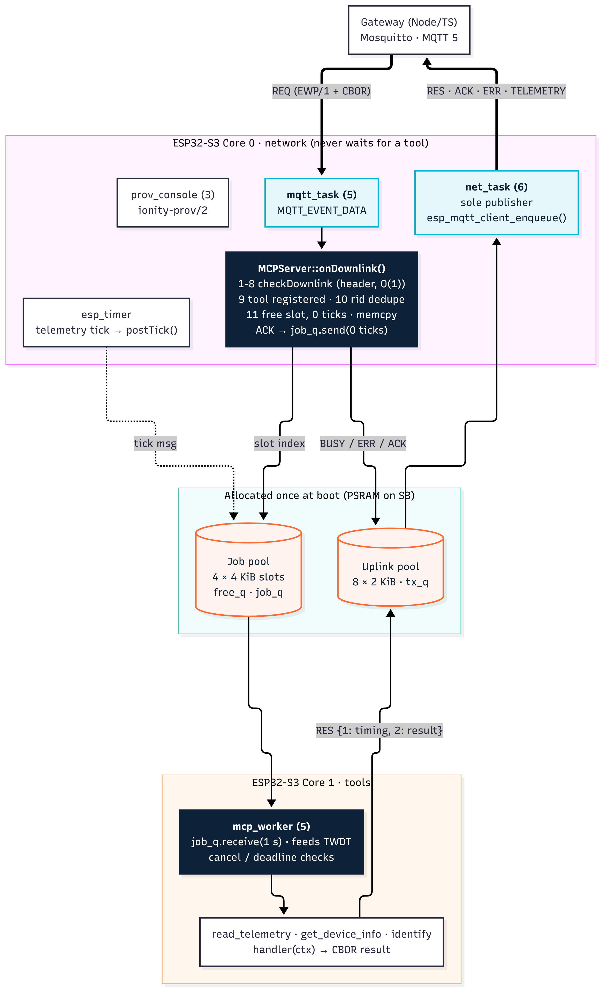
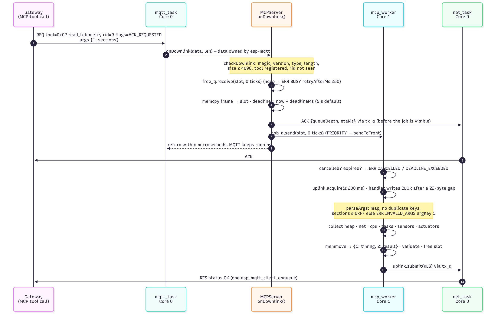

<!--
========================================================================================
AEDI - IONITY GLOBAL - ESP32-MCP SERVER & EDGE-AI FIRMWARE ECOSYSTEM
Author: Johan Wilhelm van Antwerp | Ionity (Pty) Ltd | Ionity Global (Pty) Ltd | AEDI
Document ID: DOC-2026-10-ESP32MCP-FW-P3 | Version: 1.0.0 | Updated: 2026-10-11 SAST
Governance: Policy 986 AED | License: AED 900 | CC BY-NC-SA 4.0 where stated
(c) 2018-2026 Antwerp Designs | Ionity (Pty) Ltd | Ionity Global (Pty) Ltd - All Rights Reserved - TM2
Web: https://www.ionity.today | https://www.ionity.world | Ref: https://www.ionity.co.za
Classification: PUBLIC | Building Tomorrow, Today. | Anything is Possible with God.
========================================================================================
-->

# ESP32-MCP revamp — Phase 3: Node Firmware 3 (ESP-IDF)

**Status:** delivered — waiting for `PROCEED` to the restructure · **Scope:** the on-device MCP server for
ESP32-S3 (primary) and ESP32-C6 (secondary): `main.cpp`, `MCPServer.h`, the `read_telemetry` registration and
its routing from the network core to a FreeRTOS worker without blocking the network loop, plus the board side
of `ionity-prov/2` · **Next:** restructure (D11), then `run_inference` / `set_actuator` / `set_state_mode`.

Phase 3 is additive: it adds `firmware/esp32-node/` (ESP-IDF 5.5, PlatformIO or `idf.py`) and this document.
The Arduino fw 2.x tree keeps building until the restructure.

---

## 0. What Phase 3 delivers

| Deliverable | Where | Result |
|---|---|---|
| **`main.cpp`** — boot order and task topology | `firmware/esp32-node/main/main.cpp` | Networking on Core 0, tools on Core 1 (S3); priorities decide on the single-core C6 |
| **`MCPServer.h` / `.cpp`** — registry + router | `components/mcp_server/` | Core 0 never waits for a tool: every hand-over uses 0 ticks, back-pressure is `ERR BUSY` |
| **`read_telemetry`** (0x02) + `get_device_info` (0x01) + `identify` (0x06) | `components/tools/src/EdgeTools.cpp` | Registered once at boot; run on `mcp_worker`; results encoded straight into the uplink frame |
| EWP/1 codec | `components/ewp/` | 16-byte header, bounded CBOR subset, CRC-32; wire constants generated from the TypeScript contract |
| MQTT 5 link + Wi-Fi | `components/net/` | `net_task` is the only publisher; LWT `STATUS OFFLINE` (retained); TLS via `ca_pem` or the IDF cert bundle |
| `ionity-prov/2` board side | `components/provisioning/` | All 12 obligations of Phase 2 §5; fw 2.x NVS keys read as-is and migrated once |
| Builds | `platformio.ini`, `release.py` | 4 variants (S3/C6 × UART/USB console); merged images + `manifest.json` for the portal installer |
| Verification | `test/` | 76 host unit tests (ASan/UBSan), TSan race tests, fuzzing, 5 interop tests against the TS packages |

## 1. Decisions in force

| # | Decision | Effect on Phase 3 |
|---|---|---|
| D1 | Gateway in Node/TypeScript | The firmware includes `packages/protocol/generated/ewp_protocol.h` by path — never a copy — so the gateway and the board cannot drift |
| D9 | Mosquitto now, a cluster later | MQTT 5 with clean start and session expiry 0; nothing broker-specific in the firmware |
| D10 | Confirm every risky command | Factory reset only via the portal's confirmed action; **NVS encryption / eFuse burning is documented, not enabled** (irreversible) |
| D11 | Restructure after Phase 3 | Phase 3 adds `firmware/esp32-node/` only |
| E1 | *Engineering choice, open for review:* ESP-IDF 5.5, PlatformIO-compatible | `pioarduino` platform (`framework = espidf`, `src_dir = main`) **and** plain `idf.py`; prepared for IDF 6 (managed `mqtt` / `cjson` components, not yet built) |

## 2. Task topology and request routing



*Source: `firmware_tasks.mmd`.*

| Task | Core (S3) | Priority | Stack | Role |
|---|---|---|---|---|
| Wi-Fi, lwIP, `sys_evt` | 0 | 23 / 18 / 20 | IDF | Radio and IP stack (pinned to CPU0 in `sdkconfig.defaults.esp32s3`) |
| `mqtt_task` (esp-mqtt) | 0 | 5 | 6 KiB | Receives frames; calls `MCPServer::onDownlink()` |
| `net_task` | 0 | 6 | 5 KiB | **Sole publisher**: drains `tx_q`, `esp_mqtt_client_enqueue()`; HELLO / STATUS on connect |
| `prov_console` | 0 | 3 | 6 KiB | Serial lines → `ionity-prov/2` |
| `prov_worker` | any | 2 | 4 KiB | Slow prov ops (`scan`, `test`) so the console stays responsive |
| `esp_timer` | 0 | 22 | IDF | Telemetry tick → `postTick()` (0 ticks, coalesced) |
| **`mcp_worker`** | **1** | 5 (C6: 4) | 6 KiB | Runs tool handlers one at a time; feeds the task watchdog |

On the ESP32-C6 every task is unpinned and `mcp_worker` runs at 4, below `net_task` (Phase 1 rule 9), so a
long tool can never starve publishing.

### 2.1 Why the network loop never blocks

`onDownlink()` runs in the esp-mqtt task. It does only constant-time work and every queue operation uses a
**zero timeout**:

1. **Steps 1–8** `checkDownlink()` — magic, version, type, flags, length, topic/channel, size ≤ 4096 (header
   only; the CBOR body is never parsed on Core 0).
2. **Step 9** tool registered, else `ERR UNKNOWN_TOOL`.
3. **Step 10** request id not in the 16-entry dedupe window (QoS 1 redelivery), else `ERR DUPLICATE`.
4. **Step 11** a free job slot from `free_q` with 0 ticks, else `ERR BUSY` with `retryAfterMs = 250`.
5. `memcpy` the frame into the slot — esp-mqtt reuses `data` after the callback returns, so the job never
   points into it.
6. `ACK` (if requested) into `tx_q` **before** the job becomes visible, so the gateway always sees ACK before RES.
7. `job_q.send(slot, 0)` (`sendToFront` for `PRIORITY`) and return.

The worker then checks cancel and deadline, acquires an uplink buffer (≤ 200 ms), runs the handler, which writes
its CBOR result directly into that buffer after a 22-byte gap, then memmoves it into the canonical
`{1: timing, 2: result}` body, validates it, frees the slot and submits the frame. Failures become `ERR` frames
with status, detail, `argKey` and `retryAfterMs`.

### 2.2 `read_telemetry` end to end



*Source: `read_telemetry_sequence.mmd`.*

## 3. Registering `read_telemetry`

```cpp
// components/tools/src/EdgeTools.cpp — registration (boot, before the network starts)
bool ok = server.registerTool({EWP_TOOL_READ_TELEMETRY, 1,
                               EWP_TOOL_FLAG_READ_ONLY | EWP_TOOL_FLAG_IDEMPOTENT,
                               EWP_TOOL_NAME_READ_TELEMETRY, &EdgeTools::readTelemetry, this});

// The handler — runs on mcp_worker (Core 1), never on the network core.
void EdgeTools::readTelemetry(mcp::ToolContext& ctx) {
    EdgeTools* self = static_cast<EdgeTools*>(ctx.user());
    uint8_t sections = kDefaultSections;                 // HEAP | NET | CPU | ACTUATORS (< 300 B)
    const bool ok = parseArgs(ctx, [&](uint64_t key, ewp::CborReader& r) {
        if (key == EWP_K_READ_TELEMETRY_ARGS_SECTIONS) {
            uint64_t v = 0;
            if (!r.readUint(v) || v > 0xFF) {
                ctx.fail(EWP_ST_INVALID_ARGS, "sections must be a TelemetrySection bitmask (0-255)",
                         EWP_K_READ_TELEMETRY_ARGS_SECTIONS);
                return false;
            }
            sections = static_cast<uint8_t>(v);
            return true;
        }
        return skipUnknownArg(r);                         // forward compatible
    });
    if (!ok) return;
    sections &= kSupportedSections;                       // INFERENCE / EXT arrive with run_inference
    TelemetrySnapshot& s = self->snap_;                   // static, reused: no allocation per call
    s = TelemetrySnapshot{};
    self->cfg_.source->collect(s, sections);
    s.seq = self->telemetrySeq();
    s.mode = self->mode();
    encodeTelemetryBody(ctx.out(), s, sections);          // exactly one CBOR map = the result
}

// main.cpp — the server starts the worker on the tool core
mcp::ServerConfig sc;
sc.slots = CONFIG_IONITY_JOB_SLOTS;       // 4 x 4 KiB, PSRAM when present
sc.workerCore = kToolCore;                // 1 on S3, -1 (unpinned) on C6
sc.workerPriority = kWorkerPrio;          // 5 on S3, 4 on C6 (below net_task)
s_server.begin(sc, s_uplink);
```

**Handler rules** (also in `MCPServer.h`): write exactly one CBOR item or call `ctx.fail()`; poll
`ctx.cancelled()` / `ctx.expired()` and call `ctx.keepAlive()` at least every second for long work; never keep
pointers into `ctx.args()`; never publish; never allocate per call.

## 4. Memory and safety rules

| Rule | How it is enforced |
|---|---|
| No allocation on the request path | Job pool (4 × 4 KiB) and uplink pool (8 × 2 KiB) allocated once in `begin()` (`allocPool`, PSRAM on S3); every long-lived object has static storage |
| Bounded input | `CborReader`: bounds-checked, depth ≤ 8, indefinite lengths rejected, UTF-8 validated; duplicate argument keys and trailing bytes rejected |
| Bounded output | `CborWriter` with a sticky error; a result larger than the uplink buffer becomes `ERR INTERNAL`, never an overflow |
| Oversized MQTT messages | `maximum_packet_size = 4096 + 512`; a fragmented message is answered `ERR TOO_LARGE` |
| Concurrency | Single publisher (`net_task`); relaxed atomics only for counters; recursive console mutex; uplink frames parked in FIFO order while any frame is parked (no reordering) |
| Watchdog | TWDT 10 s; the worker waits at most 1 s per receive and feeds the watchdog |
| Diagnostics | Stack canaries, heap poisoning (light), core dump to flash (ELF), run-time stats; task high-water marks in `TELEMETRY.tasks` |
| Secrets | Never logged or echoed: an `esp_log_set_vprintf` hook scrubs known secrets from every line; replies report `has_*` only |

## 5. `ionity-prov/2` obligations → implementation

| # | Obligation (Phase 2 §5) | Implementation |
|---|---|---|
| 1 | Announce at boot | `prov.announce()` after NVS load (boot step 7) |
| 2 | Accept prov/1 and prov/2 | `ProvHandler` detects `v`/`id`/CRC per line |
| 3 | CRC both ways, echo `id` | Table CRC-32 (check value 0xCBF43926 tested); mismatch → error, not executed |
| 4 | Line buffer ≥ 4096, RX ≥ 2 × | `LineAssembler` 4096 + driver RX 8192; overlong → `line too long` |
| 5 | Atomic replies | One write under the recursive console mutex shared with the log hook |
| 6 | Validate, then write | All fields validated first; one NVS handle, one `nvs_commit()`; unknown fields rejected |
| 7 | Never echo a secret | `Scrubber` on the log hook; `has_*` booleans in replies |
| 8 | `test` without reboot | `prov_worker`: Wi-Fi join (fail-fast on auth errors) + MQTT `waitConnected`, bounded by `timeout_ms` |
| 9 | `reboot` / `factory_reset` | Reply, flush, 150 ms, restart; reset erases namespace `ionity` + Wi-Fi config, not PHY calibration |
| 10 | Migrate fw 2.x | `server` + `mqtt_port` → `host_url` once; site/group sanitised; keys and types unchanged |
| 11 | Latency | `hello` answered from RAM; `set` is one NVS commit |
| 12 | NVS encryption in production | Documented (§8), **not enabled** — it burns eFuses and needs your explicit go-ahead |

## 6. Build variants

| Variant | Console | PlatformIO env | Notes |
|---|---|---|---|
| `esp32s3_usb` | USB-Serial-JTAG | `s3_usb` | Primary; native USB re-enumerates on reset (portal handles it) |
| `esp32s3_uart` | UART0 (CH340/CP210x) | `s3_uart` | |
| `esp32c6_usb` | USB-Serial-JTAG | `c6_usb` | Single core |
| `esp32c6_uart` | UART0 | `c6_uart` | |

Partition table = fw 2.x `min_spiffs` (verified against the 2.1.1 images), so installing with "Keep board
settings" preserves NVS. `release.py` checks the bootloader magic and the exact partition table of every merged
image and writes `dist/manifest.json` in the portal's format.

## 7. Verification log (2026-10-11)

| Check | Result |
|---|---|
| Host unit tests (`test/host`, ASan + UBSan): EWP codec, CBOR, MCPServer routing incl. stress, tools, provisioning | 76 / 76 |
| ThreadSanitizer, `mcp_` tests (Core 0 / Core 1 hand-over, cancel, BUSY, uplink ordering) | Clean, 3 runs |
| Fuzzing (CBOR reader, frames, prov lines, host URLs) | 40 000 iterations, no findings |
| Interop with the TypeScript packages (`@ionity/prov` client end to end, fw 2.x migration, cbor-x decode of HELLO / STATUS / TELEMETRY, TS-encoded REQ through the C++ server) | 5 / 5 |
| `idf.py` release build, ESP-IDF 5.5.5, all four variants | Pass, 0 warnings — S3 app 1.01 MB (48–49 %), C6 1.13 MB (53–54 %) of a 1.9 MB slot |
| PlatformIO (pioarduino, IDF 5.5.5), `s3_usb` | Success, flash 47.5 % |
| Configuration audit: every `sdkconfig.defaults` symbol applied | Fixed — core dump was silently off (see §9) |

## 8. Production hardening (documented, not enabled)

Flash encryption and NVS encryption (HMAC-based on S3/C6) protect Wi-Fi passwords and tokens at rest. Both burn
eFuses and **cannot be undone**; a mistake can brick a board. They stay off in Phase 3 (D10). Enabling them is a
separate, confirmed step: test on sacrificial boards, then a release variant with `CONFIG_NVS_ENCRYPTION` and
`CONFIG_FLASH_ENCRYPTION_ENABLED` in "release" mode, plus Secure Boot v2.

## 9. Known limits and next steps

- **No hardware run yet.** Everything above runs on the host or in the build; first bench test: S3 native USB,
  S3 via CH340, C6 dev kit — provision with the portal, then `read_telemetry` through the gateway.
- **Core dump fix:** `set(COMPONENTS main)` trims the build to main's dependencies, which left out
  `espcoredump`, so the core-dump settings were ignored. `main` now requires it; the build no longer reports
  unknown Kconfig symbols.
- `ws://`, `wss://` and `http://` host URLs are accepted by the portal but rejected by the Phase 3 firmware
  (MQTT over TCP/TLS only); MQTT-over-WebSocket follows with the gateway.
- `site`, `group` and `label` apply on the next reboot.
- Octal PSRAM is the S3 default (`IGNORE_NOTFOUND`, so boards without PSRAM still boot, using internal RAM).
- Uplink frames are 2 KiB; `run_inference` results larger than that need the 8 KiB contract limit and will
  get a larger pool in that phase.
- Next: the restructure (D11), then `run_inference`, `set_actuator`, `set_state_mode`, Datadog.

## 10. Running it

```bash
# PlatformIO
cd firmware/esp32-node && pio run -e s3_usb -t upload && pio device monitor
# ESP-IDF
idf.py set-target esp32s3 && idf.py build flash monitor
python release.py              # all four variants → dist/*.bin + manifest.json
npm run test:firmware          # host tests, sanitizers, fuzz, interop (needs IDF_PATH for cJSON)
```

---

*Governance: Policy 986 AED · Licence AED 900 · © 2018-2026 Antwerp Designs | Ionity (Pty) Ltd | Ionity Global (Pty) Ltd · TM2 ·
[www.ionity.today](https://www.ionity.today) · [www.ionity.world](https://www.ionity.world)*
